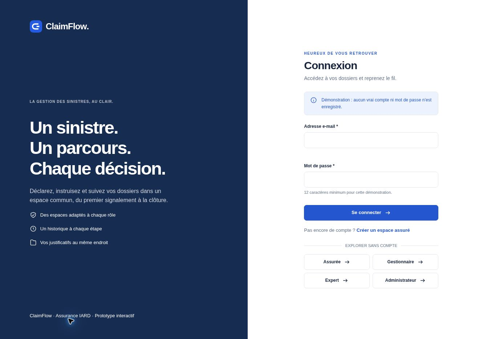
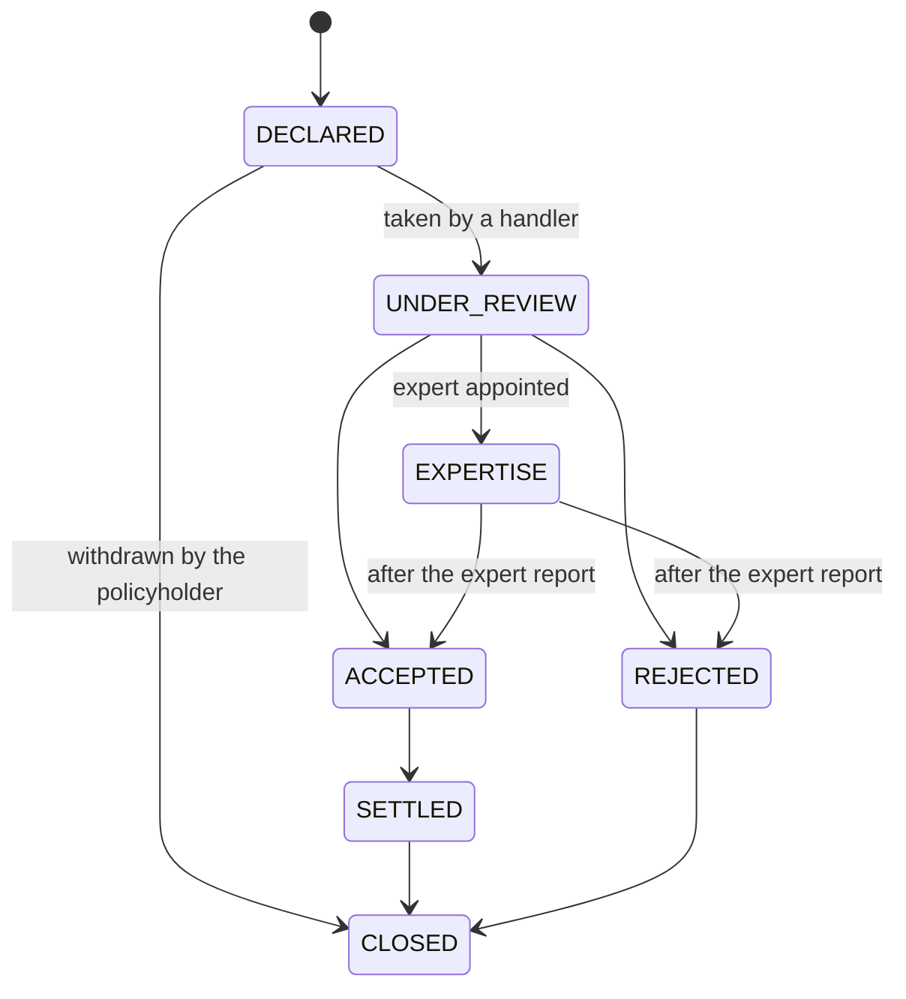

# ClaimFlow

[](https://github.com/jordachmakaya/clainflow/actions/workflows/ci.yml)


ClaimFlow is a REST API built with Express.js and TypeScript for managing property and casualty insurance claims. It replaces email and spreadsheet workflows with a structured claim lifecycle and a tamper-proof audit trail of every decision. It is designed to be deployed on AWS, with ECS Fargate, RDS PostgreSQL and S3.

> [!NOTE]
> **Project status: in active development.** The technical foundation, the data model and the authentication building blocks are in place. The business endpoints described below are not implemented yet: the only public route today is `GET /health`. See [Project status](#project-status).



*Login screen from the interactive ClaimFlow prototype. The front-end is not part of this repository, which only contains the API.*

## Table of contents

- [Overview](#overview)
- [Project status](#project-status)
- [Tech stack](#tech-stack)
- [Architecture](#architecture)
- [Planned API](#planned-api)
- [Getting started](#getting-started)
- [Configuration](#configuration)
- [Available scripts](#available-scripts)
- [Testing](#testing)
- [Deployment](#deployment)
- [Scope](#scope)
- [License](#license)

## Overview

ClaimFlow is a fictional company that handles claims for several small insurers. The API is designed around four roles:

| Role | Responsibilities |
| --- | --- |
| `POLICYHOLDER` | Declares a claim, attaches documents and tracks its progress |
| `HANDLER` | Takes claims from the queue, appoints an expert, decides and settles |
| `EXPERT` | Reviews assigned cases and submits a costed report |
| `ADMIN` | Creates staff accounts and policies, supervises overdue claims |

### Claim lifecycle



Any transition outside this flow is rejected with `409 Conflict`.

### Key business rules

These rules define the target behavior of the API.

- A claim can only be declared on the policyholder's own policy, for an incident inside the coverage period and of a type covered by the product.
- Late declarations are accepted and flagged, never rejected automatically: the deadline is 5 business days, or 2 for theft.
- Business days run from Monday to Friday, and "today" is evaluated in the `Europe/Paris` time zone.
- A rejection requires a written reason.
- Compensation equals the accepted amount minus the deductible, is never negative, and is stored in euro cents.
- Every state change is recorded in the same operation as an audit event that can never be modified or deleted.
- A claim a user may not see does not exist for that user and returns `404 Not Found`.
- Attachments are limited to PDF, JPEG and PNG files of up to 5 MB, and their content is verified.

## Project status

| Area | Status |
| --- | --- |
| Express application, security headers, structured logging, error handling | Done |
| Environment validation, graceful shutdown, `GET /health` | Done |
| Prisma schema and initial migration for users, policies, claims, events and documents | Done |
| Password hashing with scrypt | Done, not exposed by a route yet |
| JWT tokens, authentication and role middleware | Done, not exposed by a route yet |
| Business-day calendar and injectable clock | Done |
| AWS infrastructure for ECS Fargate and the load balancer | Done, not deployed |
| Authentication routes | Planned |
| Policy and claim endpoints | Planned |
| Claim state machine and business rules | Planned |
| Audit trail protection, attachments and overdue claims | Planned |
| Managed PostgreSQL and S3 in the infrastructure | Planned |

## Tech stack

| Area | Technology |
| --- | --- |
| Runtime and language | Node.js 22, TypeScript (strict) |
| API | Express.js 5, Zod, Helmet, Pino |
| Authentication | scrypt (`node:crypto`), JWT (`jose`) |
| Data | PostgreSQL, Prisma 7 |
| Testing | Vitest, Supertest |
| Code quality | Oxlint, Prettier |
| Tooling | pnpm workspaces and catalogs, Turborepo |
| Infrastructure | Docker, AWS CDK, ECS Fargate, Application Load Balancer |
| Continuous integration | GitHub Actions |

## Architecture

The application is built around a composition root: `src/container.ts` creates the dependencies and `src/app.ts` builds the Express application without starting it, which keeps it testable. Infrastructure concerns live in `src/shared`, and business features live in `src/modules`.

```text
.
├── src/
│   ├── config/          Environment validation
│   ├── modules/
│   │   ├── auth/        Password hashing, tokens and middleware
│   │   └── health/      Health check route
│   ├── shared/
│   │   ├── database/    Prisma client
│   │   ├── http/        Errors, error handler and request validation
│   │   ├── ids/         Readable reference codes
│   │   ├── logger/      Pino logger
│   │   └── time/        Business calendar and clock
│   ├── app.ts           Express application
│   ├── container.ts     Composition root
│   └── server.ts        HTTP server and graceful shutdown
├── prisma/              Schema and migrations
├── test/                Unit, end-to-end, security and load tests
├── infra/               AWS CDK application
│   ├── bin/
│   │   └── app.ts       Deployment entry point and parameters
│   ├── lib/
│   │   ├── api-service-stack.ts         VPC, ECS Fargate and load balancer
│   │   └── github-deploy-role-stack.ts  GitHub Actions deployment role
│   ├── test/            Infrastructure tests
│   └── cdk.json         CDK configuration
└── Dockerfile           Multi-stage production image
```

### Design decisions

The target design rests on the following decisions. Those not implemented yet are listed in [Project status](#project-status).

| Decision | Reason |
| --- | --- |
| State machine as a data table and a pure function | Readable by the business, exhaustively testable, no dependency |
| A single transition route instead of one route per action | Keeps all state rules in one place |
| Audit event in the same transaction as the state change | One can never exist without the other |
| PostgreSQL trigger refusing updates and deletes on audit events | Protects the trail even against a bug or a manual query |
| Compare-and-set on the claim status | Two concurrent handlers cannot both succeed, and the loser receives `409` |
| `404` rather than `403` for a claim that is not visible | Does not reveal that another user's claim exists |
| scrypt from `node:crypto`, with parameters stored in each hash | No native dependency, and hashes can be upgraded progressively |
| Short-lived HS256 JWT, without refresh tokens | Stateless and simple to deploy, at the cost of no early revocation |
| Injected clock | Deadlines and SLAs can be tested to the second |
| Amounts stored as integer cents | Avoids floating-point rounding errors |
| UUID v7 identifiers | Not guessable, and sorted by time for efficient indexes |
| `FileStorage` interface for local disk and S3 | Fast tests without AWS |

## Planned API

These endpoints are planned and not available yet.

| Method | Path | Access | Description |
| --- | --- | --- | --- |
| `POST` | `/auth/register` | Public | Creates a policyholder account |
| `POST` | `/auth/login` | Public | Returns a token |
| `GET` | `/auth/me` | Authenticated | Returns the current user |
| `POST` | `/users` | `ADMIN` | Creates a staff account |
| `GET` | `/users` | `HANDLER` (experts only), `ADMIN` | Lists users by role with pagination |
| `POST` | `/policies` | `ADMIN` | Creates a policy |
| `GET` | `/policies`, `/policies/:id` | Authenticated | Lists or reads visible policies |
| `POST` | `/claims` | `POLICYHOLDER` | Declares a claim |
| `GET` | `/claims` | Authenticated | Lists visible claims with pagination |
| `GET` | `/claims/overdue` | `HANDLER`, `ADMIN` | Lists overdue claims |
| `GET` | `/claims/:id` | Claim visibility | Reads a claim and its available transitions |
| `POST` | `/claims/:id/transitions` | Depends on the transition | Changes the claim status |
| `POST` | `/claims/:id/expert-report` | Assigned `EXPERT` | Submits the expert report |
| `GET` | `/claims/:id/events` | Claim visibility | Reads the audit trail |
| `POST` | `/claims/:id/documents` | Claim visibility | Uploads an attachment |
| `GET` | `/claims/:id/documents` | Claim visibility | Lists attachments |
| `GET` | `/claims/:id/documents/:docId/content` | Claim visibility | Downloads an attachment |

## Getting started

### Prerequisites

- Node.js 22.12 or later
- pnpm 12
- Docker, to run PostgreSQL locally

### Installation

```bash
git clone https://github.com/jordachmakaya/clainflow.git
cd clainflow
pnpm install
cp .env.example .env
pnpm run db:generate
```

### Start the database

```bash
docker run -d --name claimflow-db \
  -e POSTGRES_PASSWORD=fakePassWord \
  -e POSTGRES_DB=mydb \
  -p 5432:5432 \
  postgres:17

pnpm run db:deploy
```

### Run the API

```bash
pnpm run dev
```

The API listens on port 3000:

```bash
curl http://localhost:3000/health
# {"status":"OK"}
```

### Run with Docker

```bash
docker build -t claimflow .

docker run --rm -p 3000:3000 \
  -e PORT=3000 \
  -e JWT_SECRET=<at-least-32-characters> \
  -e DATABASE_URL=<postgresql-url> \
  claimflow
```

## Configuration

Variables are validated at startup by `src/config/env.ts`. The application refuses to start if the configuration is invalid. See `.env.example` for a local setup.

| Variable | Required | Default | Description |
| --- | --- | --- | --- |
| `JWT_SECRET` | Yes | | Token signing secret, at least 32 characters |
| `DATABASE_URL` | Yes, unless `DB_*` is set | | PostgreSQL connection URL |
| `DB_HOST`, `DB_PORT`, `DB_NAME`, `DB_USER`, `DB_PASSWORD` | Yes, unless `DATABASE_URL` is set | | Connection settings used to build the URL |
| `NODE_ENV` | No | `development` | `development`, `test` or `production` |
| `PORT` | No | `3000` | HTTP port |
| `LOG_LEVEL` | No | `info` | Pino log level |
| `JWT_TTL_SECOND` | No | `3600` | Token lifetime in seconds |
| `PASSWORD_SCRYPT_LOG2N` | No | `17` | scrypt cost, at least 17 in production |
| `SLA_UNDER_REVIEW_DAYS` | No | `10` | Days before a claim under review is overdue |
| `FILE_STORAGE_DRIVER` | No | `local` | `local` or `s3` |
| `UPLOAD_DIR` | No | `./upload` | Local storage directory |
| `S3_BUCKET`, `S3_REGION` | With `s3` | | Attachment storage |
| `MAX_UPLOAD_BYTES` | No | `5242880` | Maximum upload size |

## Available scripts

| Script | Description |
| --- | --- |
| `pnpm run dev` | Starts the API in watch mode |
| `pnpm run build` | Compiles TypeScript to `dist` |
| `pnpm run start` | Runs the compiled application |
| `pnpm run typecheck` | Checks types |
| `pnpm run lint` | Runs Oxlint |
| `pnpm run format` | Formats the code with Prettier |
| `pnpm run test` | Runs all API tests |
| `pnpm run test:unit` | Runs unit tests |
| `pnpm run test:e2e` | Runs end-to-end tests |
| `pnpm run test:security` | Runs the security oracle |
| `pnpm run test:coverage` | Runs tests and enforces coverage thresholds |
| `pnpm run test:stress` | Runs the local load test with Docker |
| `pnpm run test:all` | Runs the tests of every package with Turborepo |
| `pnpm run db:migrate` | Creates and applies a development migration |
| `pnpm run db:deploy` | Applies pending migrations |
| `pnpm run synth:infra` | Generates the CloudFormation template |

## Testing

```bash
pnpm run test:coverage
```

Coverage is enforced at a minimum of 80% for lines, branches, functions and statements. The CI pipeline also runs lint, type checks, infrastructure tests and a build. Unit tests run a second time in a UTC+14 time zone to confirm that date logic does not depend on the server time zone.

Load test results and their exact conditions are published in test reports:

- [October 30, 2026](test-report-2026-30-10.md): password hashing performance and first load test

### Security oracle

`test/security/auth.oracle.test.ts` plays the attacker against `AuthService` and the authentication schemas, then checks a security invariant after each attempt. It runs with `pnpm run test:security`.

The oracle uses the real scrypt hasher and real JWT tokens where the scenario depends on them, with an in-memory repository. It calls the service directly, so it does not go through HTTP or PostgreSQL. Token forgery scenarios exercise `TokenService` on tokens issued by `AuthService`. Enumeration resistance is checked by comparing the error returned and the hashing work performed, not by measuring response times. A passing scenario shows that this attack failed against this code, not that the code is free of vulnerabilities.

#### What the oracle failed to break

| Attack | Result |
| --- | --- |
| Altered passwords, including case, spaces, truncation and null bytes | Refused, with the same error as a wrong password |
| Pass-the-hash with a stolen hash | Refused |
| Logging in with the internal decoy password | Refused |
| Overwriting a stored hash with a wrong password | Stored hash unchanged |
| Corrupted stored hashes, including memory bombs and lowered costs | Refused without a crash |
| Account enumeration on login | Same error and same hashing work for an unknown email and a wrong password |
| Privilege escalation through the request body or by bypassing the schema | Account stays `POLICYHOLDER` |
| Prototype pollution through `__proto__` and `constructor` | Keys dropped, prototype untouched |
| Account pre-hijacking with look-alike emails (Unicode, invisible characters, case) | Refused or matched to the existing account |
| SQL and header injection in emails, Prisma operators and type confusion | Refused by the schemas |
| ReDoS on the email field, and 1,000 seeded random inputs | No crash, parsing stays under the time limit |
| Oversized passwords | Refused before scrypt runs |
| Weak passwords at registration: blank, repeated, sequences and common passwords | Refused by the schemas |
| Line breaks, null bytes and right-to-left override characters in `fullName` | Refused by the schemas |
| Bursts of unknown emails, and a decoy hash failure during a burst | One hash computed, service recovers |
| Concurrent registrations for one email | One account created, the others receive `409` |
| Concurrent password rehashes | Account stays usable, with the stronger hash |
| Forged tokens: edited role, stripped signature, `alg=none`, RS256/HS256 confusion, wrong secret, wrong algorithm, wrong issuer or audience, expired | Refused with `401` |
| Reading another profile with a crafted identifier | Not found, and a token only returns its own account |
| Stolen database: identical passwords, plaintext search, cost downgrade | Unique salted hashes, cost never lowered |
| Secret leaks in responses, tokens and errors | No password or hash exposed |
| Failures during login (hash check, database, token signing) | No session issued, and never an empty response |

The weak password rule applies when an account is created, not at login, so an existing account keeps working. It catches obvious patterns and a short built-in list. It does not replace a check against known breaches.

#### Not covered

These scenarios need a new feature or a decision, and are tracked as `todo` in the oracle:

- Rate limiting against credential stuffing and password spraying.
- Hiding whether an email has an account at registration, which currently returns `409 Email already exists`.
- Checking passwords against known breaches.
- Revoking a token after an account is deleted or a role changes. Session revocation is out of [scope](#scope), so a token stays valid until it expires.

## Deployment

The API is designed to run on AWS. The target production setup is ECS Fargate behind an Application Load Balancer, with RDS PostgreSQL for data and a private, encrypted S3 bucket for attachments. Nothing is deployed yet.

The `infra` package is an AWS CDK application that currently describes a VPC, an ECS Fargate service and a public Application Load Balancer. It builds the production image from the root `Dockerfile` and reads application secrets from AWS Secrets Manager.

```bash
pnpm --filter infra run bootstrap
pnpm --filter infra run deploy
```

Deployments are manual: pushing to `main` runs the CI pipeline but does not deploy anything. Before a production deployment, the stack still needs RDS PostgreSQL, an S3 bucket and an HTTPS listener.

> [!CAUTION]
> **With the current limits (0.25 vCPU, 512 MB), 4 concurrent logins kill the container.** Each password hash needs about 128 MB of memory. Before exposing a real `/login` route:
>
> - Set `UV_THREADPOOL_SIZE=2` in the task environment. In the local load test, the container then survived up to 32 concurrent logins.
> - Rate limit login attempts, because a burst of requests is enough to take the API down.
>
> See the [October 30, 2026 test report](test-report-2026-30-10.md) for the measurements and their conditions.

## Scope

The following topics are intentionally out of scope: front-end, email notifications, real payments, public holidays, natural disaster deadlines, refresh tokens and session revocation, online underwriting, antivirus scanning and multi-tenancy.

Legal rules are simplified for this project and do not constitute legal advice.

## License

Released under the MIT License, as declared in `package.json`.
