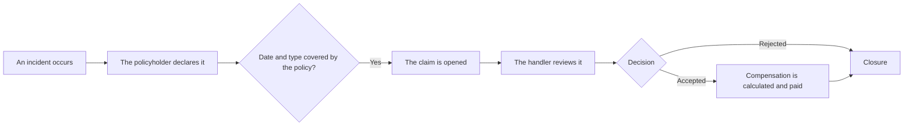
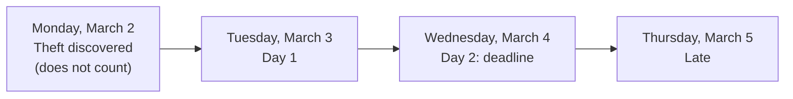
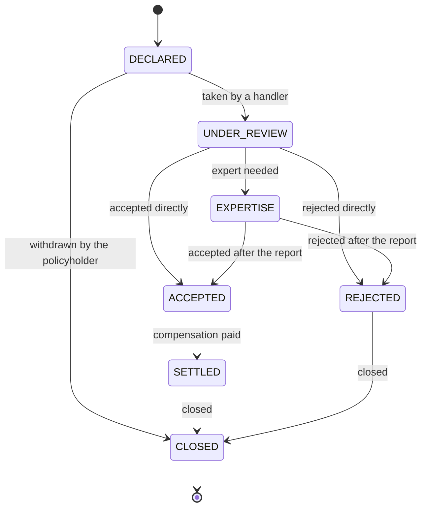
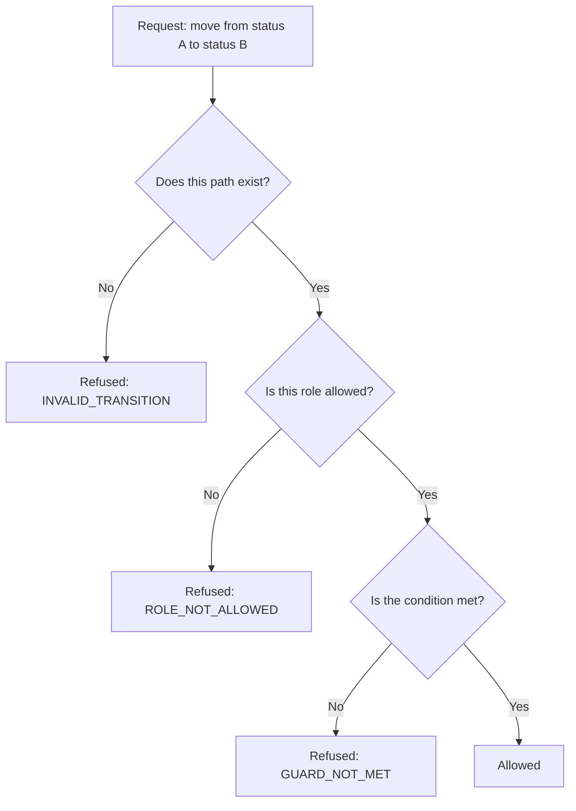
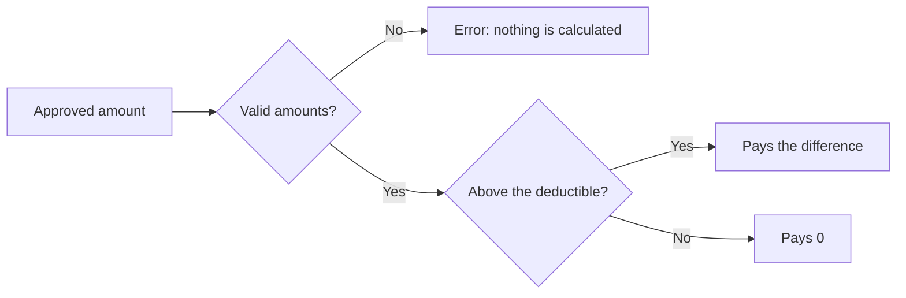
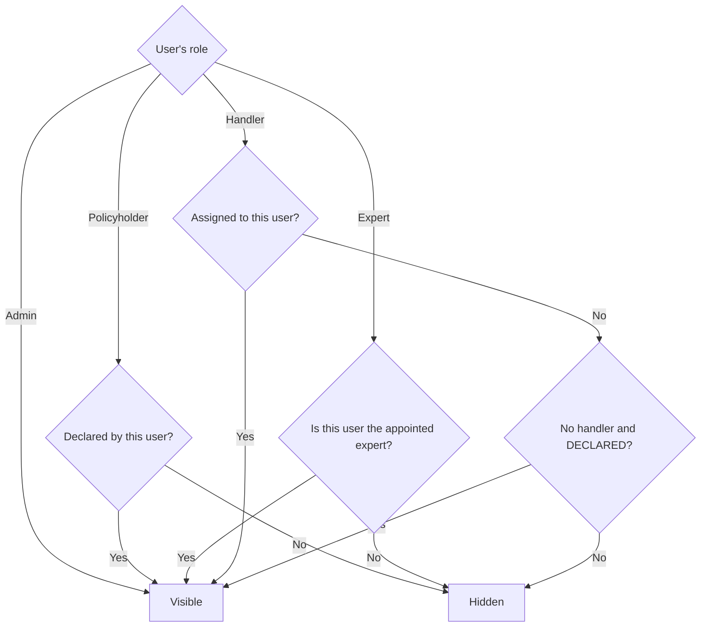

# Claim business rules

This document explains what the code in this folder does, with no insurance background required. It only describes what is **implemented today** in three files:

| File | The question it answers |
| --- | --- |
| `claim-rules.ts` | Is the incident covered? Was it reported late? How much is paid? |
| `claim-state-machine.ts` | Which steps does a claim go through, and who can move it forward? |
| `claim-access.ts` | Who is allowed to see which claim? |

These files contain **pure functions**: they receive values and return an answer. They do not read the database, know nothing about HTTP and never look at the clock. Other layers, still to be written, will call them (see [What is not implemented here](#what-is-not-implemented-here)).

## Vocabulary in 2 minutes

| Term | What it means | Example |
| --- | --- | --- |
| **Policyholder** | The person who took out the insurance | Alex insures an apartment |
| **Policy** | The agreement with the insurer: what is covered, and for how long | Home policy from 01/01/2026 to 12/31/2026 |
| **Incident** | The event that causes the damage | A leak floods the kitchen |
| **Claim** | The insurer's file for an incident, from declaration to closure | `SIN-2026-7K3F9Q2M` |
| **Handler** | The employee who reviews the claim and decides | Accepts or rejects the claim |
| **Expert** | The professional appointed to assess the damage | Estimates the damage in a report |
| **Deductible** | The part of the damage the policyholder pays | €150 per incident |
| **Approved amount** | The amount of damage the handler agrees to take into account | €1,500 |
| **Compensation** | The amount actually paid to the policyholder | €1,500 − €150 = €1,350 |

## The big picture



## 1. Is the incident covered?

*File: `claim-rules.ts`*

Two conditions are checked separately.

### The date: did the incident happen during the policy?

The first and last days of the policy are included.

```ts
export function isWithinCoverage(policy:CoveragePeriod, occurredOn:Date):boolean {
    return occurredOn >= policy.coverageStart && occurredOn <= policy.coverageEnd;
}
```

For a policy running from January 1 to December 31, 2026:

| Incident date | Result | Why |
| --- | --- | --- |
| December 31, 2025 | Not covered | The day before the start |
| January 1, 2026 | Covered | First day included |
| June 15, 2026 | Covered | During the policy |
| December 31, 2026 | Covered | Last day included |
| January 1, 2027 | Not covered | The day after the end |

### The type: does the product cover this kind of incident?

ClaimFlow offers two products: home (`HOME`) and motor (`MOTOR`).

| Incident type | Code | Home | Motor |
| --- | --- | --- | --- |
| Water damage | `WATER_DAMAGE` | Yes | No |
| Fire | `FIRE` | Yes | Yes |
| Theft | `THEFT` | Yes | Yes |
| Glass breakage | `GLASS_BREAKAGE` | Yes | Yes |
| Vehicle collision | `VEHICLE_COLLISION` | No | Yes |

```ts
isCoveredType(PolicyProduct.HOME, ClaimType.FIRE)              // true
isCoveredType(PolicyProduct.HOME, ClaimType.VEHICLE_COLLISION) // false
```

## 2. Was the claim declared late?

*File: `claim-rules.ts`*

The policyholder has a limited time to notify the insurer. This period starts on the day the incident is **discovered**, not the day it happened: if Alex comes back from vacation and finds a flooded kitchen, the period starts on the day of return.

| Incident type | Deadline |
| --- | --- |
| Theft | **2 business days** |
| All others | **5 business days** |

A **business day** is any day from Monday to Friday. The day of discovery does not count, and the last day of the period is still on time.



Saturdays and Sundays are skipped:

| Incident | Discovered on | Deadline | Days counted |
| --- | --- | --- | --- |
| Theft | Monday, March 2 | Wednesday, March 4 | Tuesday, Wednesday |
| Theft | Friday, March 6 | Tuesday, March 10 | Monday, Tuesday |
| Theft | Saturday, March 7 | Tuesday, March 10 | Monday, Tuesday |
| Fire | Monday, March 2 | Monday, March 9 | Tuesday, Wednesday, Thursday, Friday, Monday |

```ts
export function declarationDeadLine(type:ClaimType, discoveredOn:Date):Date{
    return addBusinessDays(discoveredOn, DECLARATION_DELAY_BUSINESS_DAYS[type])
}
```

### A late declaration is not a rejection

This is the most important part of the rule: **a late declaration is flagged, never rejected.** French law (article L113-2 of the Insurance Code) only lets an insurer rely on a late declaration if it proves the delay caused it harm. The function therefore simply answers yes or no, and the handler assesses the situation afterwards.

```ts
export function isLateDeclaration(type:ClaimType, discoveredOn:Date, declaredOn:Date):boolean{
    return !(declaredOn <= declarationDeadLine(type, discoveredOn))
}
```

The formula is deliberately written the other way around for safety: if a date is invalid, the claim is flagged as late instead of passing as on time.

### Limits of this rule

- **Public holidays:** they are not taken into account. A May 1 falling on a weekday counts as a business day.
- **Time zones:** dates are days without a time, stored at midnight UTC. The declaration day must be computed in Paris time with `calendarDateIn(...)`. Without this conversion, a declaration made at 10 a.m. on the last day would count as late.

## 3. The life of a claim

*File: `claim-state-machine.ts`*

A claim always has **exactly one status**. It can only change status by following a planned path. This is called a **state machine**.



| Status | Meaning |
| --- | --- |
| `DECLARED` | Declared: nobody is working on it yet |
| `UNDER_REVIEW` | Being reviewed by a handler |
| `EXPERTISE` | Waiting for an expert report |
| `ACCEPTED` | Accepted: the insurer takes it on |
| `REJECTED` | Rejected |
| `SETTLED` | Settled: the compensation has been paid |
| `CLOSED` | Closed: final status, nothing can leave it |

### Who can do what

The code describes these paths as a table of data, which makes them easy to review:

```ts
export const CLAIM_TRANSITIONS: readonly TransitionRules[] = [
    { from: ClaimStatus.DECLARED, to: ClaimStatus.UNDER_REVIEW, roles:STAFF},
    {from:ClaimStatus.DECLARED, to:ClaimStatus.CLOSED,roles: [Role.POLICYHOLDER]},
    // ...
    {
        from:ClaimStatus.EXPERTISE,
        to:ClaimStatus.ACCEPTED,
        roles:STAFF,
        guard:"EXPERT_REPORT_REQUIERED",
    },
    // ...
]
```

Here is the full table, where `STAFF` means handlers and admins:

| From | To | Who | Condition |
| --- | --- | --- | --- |
| `DECLARED` | `UNDER_REVIEW` | Handler, admin | — |
| `DECLARED` | `CLOSED` | **Policyholder only** | — |
| `UNDER_REVIEW` | `EXPERTISE` | Handler, admin | — |
| `UNDER_REVIEW` | `ACCEPTED` | Handler, admin | — |
| `UNDER_REVIEW` | `REJECTED` | Handler, admin | — |
| `EXPERTISE` | `ACCEPTED` | Handler, admin | **Expert report submitted** |
| `EXPERTISE` | `REJECTED` | Handler, admin | **Expert report submitted** |
| `ACCEPTED` | `SETTLED` | Handler, admin | — |
| `SETTLED` | `CLOSED` | Handler, admin | — |
| `REJECTED` | `CLOSED` | Handler, admin | — |

What this table means in practice:

- **Anything not listed is forbidden.** There is no going back: an accepted claim does not return to review, and a closed claim cannot be reopened.
- **A policyholder can only withdraw**, and only while the claim is `DECLARED`.
- **An admin cannot withdraw on behalf of a policyholder.**
- **An expert never changes a claim's status.** The report is a condition for the handler's decision.
- **A rejected claim can never be settled.**

### How a request is decided

`decideTransition` always runs three checks, in this order:



```ts
decideTransition(DECLARED, SETTLED, ADMIN, {hasExpertReport: true})
// {allowed: false, reason: 'INVALID_TRANSITION'}: the path does not exist

decideTransition(DECLARED, UNDER_REVIEW, POLICYHOLDER, {hasExpertReport: false})
// {allowed: false, reason: 'ROLE_NOT_ALLOWED'}: a policyholder cannot take a claim

decideTransition(EXPERTISE, ACCEPTED, HANDLER, {hasExpertReport: false})
// {allowed: false, reason: 'GUARD_NOT_MET'}: no decision without the report

decideTransition(EXPERTISE, ACCEPTED, HANDLER, {hasExpertReport: true})
// {allowed: true, rule: ...}
```

Only the value `true` counts as a submitted report. The text `'false'` or the number `1` is not enough.

### What this function does not check

- **The role, not the person:** `decideTransition` knows the user is a handler, not that this handler is in charge of **this** claim. The visibility rule in [section 5](#5-who-can-see-which-claim) must filter first.
- **The buttons to display:** `availableTransitions` lists what a role can do from a status, without looking at the expert report. In `EXPERTISE` without a report, it still offers `ACCEPTED` and `REJECTED`, which `decideTransition` will refuse.

## 4. How much is paid to the policyholder?

*File: `claim-rules.ts`*

The formula is simple:

> **Compensation = approved amount − deductible, never below 0**

```ts
export function computeIndemnity(approvedAmount:number, deductibles:number):number {
    if(!isCents(approvedAmount) || !isCents(deductibles)) {
        throw new RangeError('Amounts must be non-negative integers of cents')
    }
    return Math.max(0, approvedAmount - deductibles)
}
```



| Approved amount | Deductible | Compensation | Explanation |
| --- | --- | --- | --- |
| €1,500 | €150 | **€1,350** | Normal case |
| €150 | €150 | **€0** | The damage equals the deductible |
| €100 | €150 | **€0** | The policyholder bears all the damage |
| €150 | €0 | **€150** | Policy without a deductible |

### Amounts are in cents

The code works with **whole cents**, never decimal euros, because decimal numbers cause rounding errors: in JavaScript, `0.1 + 0.2` is not exactly `0.3`.

```ts
computeIndemnity(150_000, 15_000) // 135_000, that is €1,350.00
computeIndemnity(10_000, 15_000)  // 0
```

Any amount that is negative, decimal, infinite or not a number raises an error. The code would rather block the calculation than produce a wrong payment: with a deductible of −50, an approved amount of 100 would otherwise pay 150.

### When the damage is below the deductible

The code does not reject the claim automatically: it returns 0. The claim can therefore be accepted, then settled for €0. To get a `REJECTED` claim, the handler has to make that decision.

## 5. Who can see which claim?

*File: `claim-access.ts`*

A claim contains personal information, so everyone only sees what concerns them.

| Role | What it can see |
| --- | --- |
| Policyholder | The claims this user declared |
| Handler | The claims assigned to this user, and the **queue** |
| Expert | The claims where this user is the appointed expert |
| Admin | All claims |

The **queue** contains the claims waiting to be taken: they have no handler and are still `DECLARED`.



```ts
export function  canViewClaim(user:AuthUser, claim:ClaimOwnerShip):boolean{
    const scope = visibilitéScope(user)
    switch (scope.kind) {
        case 'all':
            return true
        case 'declarant':
            return claim.declarantId === scope.userId
        case 'handler':
            return (
                claim.handlerId === scope.userId ||
                (claim.handlerId === null && claim.status === scope.queueStatus)
            )
        case 'expert':
            return claim.expertId === scope.userId
    }
}
```

Being linked to a claim gives no extra rights: only the account's role matters. A handler who also declared a claim cannot see it if it is assigned to a colleague.

### One rule for details and lists

The code needs this rule twice: for **one** claim already loaded, and for a **list**, where the database has to do the filtering. Two versions of the rule could end up disagreeing, with a claim readable through its link but missing from the list.

`visibilitéScope` therefore describes the filter as data, and both cases rely on it:

```ts
visibilitéScope({id: 'u1', role: Role.ADMIN})
// {kind: 'all'}

visibilitéScope({id: 'u1', role: Role.HANDLER})
// {kind: 'handler', userId: 'u1', queueStatus: 'DECLARED'}
```

## What is not implemented here

These rules are part of the project, but they are **not** in this folder yet. No function here enforces them:

| Rule | Where it will live |
| --- | --- |
| A policyholder can only declare on their own policies | Service |
| No future dates, and discovery cannot precede the incident | Schema and service |
| Taking a claim assigns it to the handler | Service |
| A rejection needs a written reason of at least 10 characters | Schema |
| Refusing an incident outside the coverage or of an uncovered type | Service, using the functions above |
| Overdue claims (10 days by default in `UNDER_REVIEW`) | Service |
| Audit trail of every status change | Service and database |
| Attachments | Dedicated service |
| HTTP responses: `409` for a refused path or condition, `403` for a refused role, `404` for a hidden claim | Service and routes |

## Going further

- The tests give runnable examples of every rule: `test/modules/claims/`.
- The security oracle plays out attack scenarios: `test/security/claims.oracle.test.ts`.
- `PROJECT_DESCRIPTION.md` lists rules R1 to R14, and `PROJECT_ARCHI.md` explains the architecture choices.
- This document simplifies insurance law and is not legal advice.
